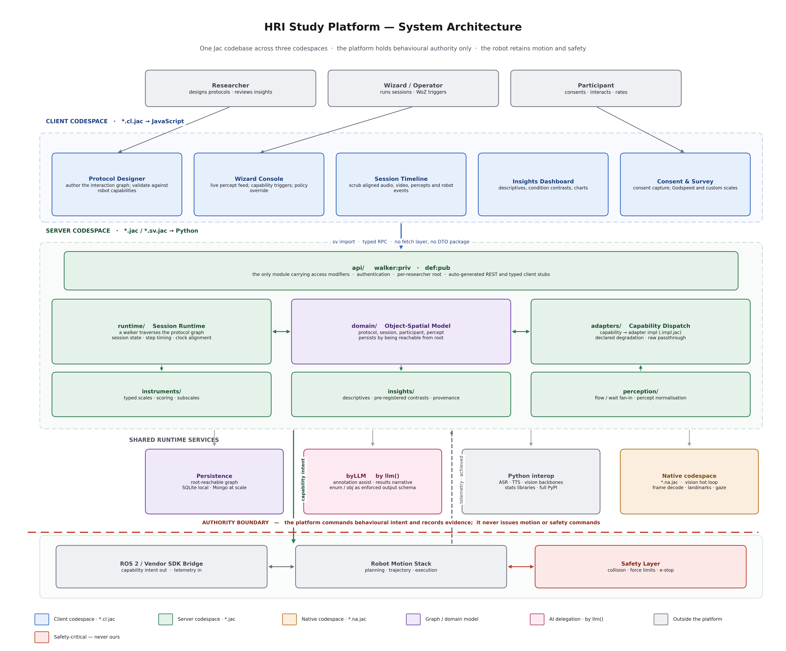
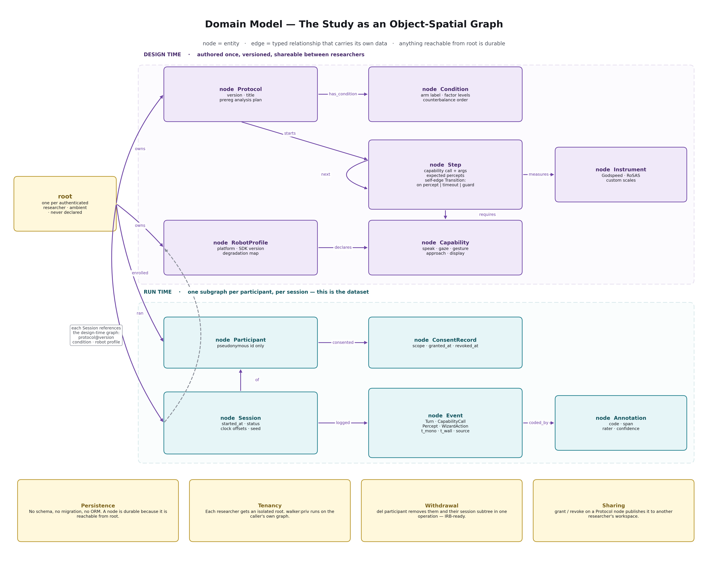

# Handshake

**An open-source platform for designing, running and analysing human-robot
interaction studies — built entirely in [Jac](https://www.jac-lang.org).**

> Status: **v0 walking skeleton.** Every layer exists end to end and runs with
> no hardware. Depth comes next. See [Roadmap](#roadmap).

HRI research has a tooling gap. ROS is excellent at control and has no concept
of an experiment. PsychoPy and jsPsych are excellent at experiments and have no
concept of an embodied agent in shared physical space. Most labs bridge that gap
with a Wizard-of-Oz GUI, a separate recording rig, a spreadsheet of condition
assignments, and glue scripts only one student understands.

Handshake is the missing experiment layer: **design once, run on any robot, and
get a reproducible dataset instead of a folder of videos.**

*The name is doubly apt: a handshake is the canonical human-robot interaction,
and it is also what two systems do to agree on a protocol before exchanging
anything meaningful.*

---

## The idea in one line

> **A study protocol is a graph. A session is a walker traversing it. The
> transcript is the trail the walker leaves behind.**

That is not a metaphor. A protocol *is* a directed graph with conditional
branches and timeouts. Running a participant through it *is* a stateful agent
moving through that topology. Jac's object-spatial model expresses this
directly, so the protocol is the data structure and the walker is the runtime.

---

## Try it in 60 seconds

```bash
pip install jaclang==0.16.7
git clone https://github.com/Divakaran99/Handshake.git && cd Handshake
jac run examples/proxemics/build_study.jac
```

That builds a two-condition greeting study, runs two participants through it on
a simulated robot, branches on a gaze percept in one condition and on a timeout
in the other, and prints per-condition descriptives:

```
================ DESCRIPTIVES ================
session           cond     steps  events  percepts  fails     ms
S-P01-near        near         5      17         1      1      9
S-P02-far         far          5      16         0      1      4
```

No hardware. No database. No configuration.

---

## Design commitments

These are load-bearing. Changing them changes the project.

### 1. Behavioural authority only

| Authority | Meaning | Owner |
|---|---|---|
| **Behavioural** | *what* the robot does and when | **Handshake** |
| Motion | *how* a goal is achieved — trajectory, joints | Robot stack |
| Safety | collision, force limits, e-stop | **Never Handshake** |

Protocols express intent — `approach(stop_distance=1.2, speed=0.4)`,
`gaze(target=face, hold_ms=1800)` — which is exactly what HRI researchers
manipulate as independent variables. The robot's own certified stack executes
it. Handshake records **commanded vs. achieved**, so "we set approach speed to
0.4 m/s" becomes "commanded 0.4; achieved median 0.31" — a methods contribution
most HRI papers cannot currently make.

### 2. Protocols are authored against capabilities, never robots

A robot profile declares which capabilities it supports, and how it degrades
when it cannot. The simulated robot deliberately declares `APPROACH` as
`UNAVAILABLE` and `EXPRESS` as `SUBSTITUTED` by `DISPLAY`, so the degradation
path is exercised on every CI run rather than only on exotic hardware.

### 3. Everything runs with no robot

`SimAdapter` is the reference implementation, the CI target, and the
contributor on-ramp. Real hardware is the special case.

### 4. Analysis plans are versioned with the protocol

A tool that makes it trivial to run 40 comparisons and surface the significant
ones is a p-hacking machine. `StudyProtocol.prereg` is part of the versioned
protocol; anything computed afterwards is marked exploratory.

---

## Architecture





```
Handshake/
├── domain/         nodes, edges, enums — knows nothing about HTTP or robots
│   ├── capability.jac      the capability taxonomy (start here)
│   ├── protocol.jac        StudyProtocol, Condition, Step, Next
│   ├── participant.jac     Participant, ConsentRecord
│   └── session.jac         Session, Event, EventKind
├── adapters/       the robot seam
│   ├── adapter.jac         abstract RobotAdapter interface
│   └── sim.jac             reference simulated robot
├── runtime/
│   ├── clock.jac           single monotonic reference + per-source offsets
│   └── session_runtime.jac the session walker
├── instruments/    typed scales (Godspeed included)
├── insights/       descriptive metrics off the session subgraph
├── api/            the ONLY module with access modifiers
├── examples/       runnable reference study
└── verify/         assertion suite
```

Two conventions worth keeping:

- **`api/` is the only place `walker:priv` / `def:pub` appears.** Auditing the
  network surface means reading one file.
- **`domain/` never imports from `api/` or `adapters/`.** The domain does not
  know a server or a robot exists.

---

## What Jac gives us for free

| Capability | Mechanism |
|---|---|
| Persistence, no ORM or migrations | reachability from `root` |
| Per-researcher isolation | `walker:priv` runs on the caller's own root |
| Participant withdrawal (IRB / GDPR) | `del participant` cascades the subtree |
| Typed REST + client stubs | generated from `walker:priv` signatures |
| Protocol sharing between labs | `grant` / `revoke` on a node |

---

## Roadmap

**v0 — walking skeleton (current).** Capability taxonomy, protocol graph,
session walker with percept and timeout branching, sim adapter with degradation
and commanded-vs-achieved telemetry, typed instruments, descriptive metrics,
private API surface, runnable reference study.

**v1 — autonomy and perception.** Real voice pipeline (VAD → ASR → TTS), three
vision percepts (face presence, gaze-on-robot, distance), Wizard-of-Oz console,
session replay, the second robot adapter — the real test of the abstraction.

**v2 — the platform claim.** Annotation studio with inter-rater reliability,
AI-assisted pre-annotation via `by llm()`, condition contrasts with effect
sizes, protocol sharing, adapter plugin ecosystem.

---

## Known issues in the toolchain

Found while building this, on jaclang 0.16.7. Documented because this repo also
serves as a real-world Jac showcase.

| Issue | Workaround |
|---|---|
| `round(x, n)` runs fine but fails `jac check` (stub gap) | fixed-point arithmetic; see `adapters/sim.jac` |
| A node named `Protocol` collides with ambient `typing.Protocol` | named `StudyProtocol` |
| `jac test` fails with a bytecode-cache error in some environments | assertion suite in `verify/run_all.jac` |
| Edge entry/exit abilities compile but never fire (documented Jac limitation) | edge logic lives in walker node abilities |
| `report` also prints to stdout | expected; read `result.reports` |
| Untyped `dict` fields make `.get()` return `any` and trip the strict-any rule | type the field: `dict[str, str]` |

## Development

```bash
for f in $(find domain adapters runtime instruments insights api examples verify -type f -name '*.jac'); do jac check "$f"; done
jac run verify/run_all.jac
jac run examples/proxemics/build_study.jac
```

## License

Apache-2.0 — chosen over MIT for the explicit patent grant, which matters in
robotics.

## Citation

If Handshake supports published work, please cite the repository and the
original instruments you used (e.g. Godspeed: Bartneck et al., 2009).
