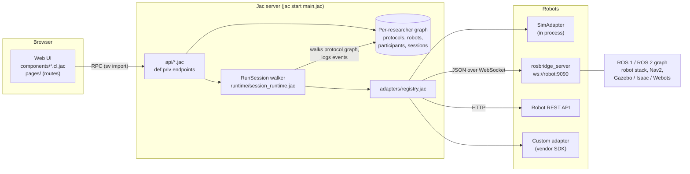

# Handshake build guide

How the Handshake application is put together on the Jac stack, how to connect
real robots, ROS systems and simulators to it, and how to run, deploy and extend
it. Written for the lab member who has to make it work on Monday.

- [1. The application in one picture](#1-the-application-in-one-picture)
- [2. Run it locally](#2-run-it-locally)
- [3. How the Jac stack is used](#3-how-the-jac-stack-is-used)
- [4. Connecting robots](#connecting-robots)
- [5. Designing a study](#5-designing-a-study)
- [6. Running sessions](#6-running-sessions)
- [7. The dataset](#7-the-dataset)
- [8. Scripting against the API](#8-scripting-against-the-api)
- [9. Deploying for a lab](#9-deploying-for-a-lab)
- [10. Testing](#10-testing)
- [11. Troubleshooting](#11-troubleshooting)
- [12. What to build next](#12-what-to-build-next)

---

## 1. The application in one picture



One process serves both the API and the web UI. The browser never talks to a
robot; the server does, through an adapter chosen from the robot's profile.
That keeps credentials, network access and the dataset in one place, and it
means the machine running `jac start` must be able to reach the robot.

The data model is two graphs per researcher:

```
design time   StudyProtocol -HasCondition-> Condition -Starts-> Step -Next-> Step ...
                                                              (Next edges carry on_percept / on_timeout)
run time      Participant -Ran-> Session -Logged-> Event, Event, ...
              StudyProtocol -Produced-> Session
              RobotProfile (hangs off root)
```

A session is the `RunSession` walker visiting the condition's steps. Every
visit logs events on the session node, so the dataset is literally the trail
the walker leaves.

---

## 2. Run it locally

### On Ubuntu (24.04 recommended, 22.04 supported)

```bash
git clone https://github.com/Divakaran99/Handshake.git && cd Handshake
bash scripts/setup_ubuntu.sh              # Handshake only, ~3 minutes
bash scripts/setup_ubuntu.sh --with-ros   # also ROS 2 + rosbridge on this machine
```

The setup script installs `python3-venv`, creates `.venv` with the Jac stack
(`jaseci==2.3.28`, which needs Python 3.12 or newer), fetches the web UI's
packages (a project-local `bun` is downloaded automatically, no Node needed) and
runs the 54-assertion self-test. With `--with-ros` it installs ROS 2 through the
official `ros2-apt-source` package — **Jazzy on 24.04, Humble on 22.04** — plus
`rosbridge-suite`. If ROS is already installed it only adds rosbridge.

On 22.04 the system Python is 3.10, so the script adds Python 3.12 from the
deadsnakes PPA for Handshake only. ROS keeps using the system Python; the two
never share an interpreter because Handshake talks to ROS over rosbridge.

Then start everything with one command (Ctrl+C stops all of it; logs of the
background processes go to `.jac/logs/`):

```bash
bash scripts/start_lab.sh                  # web app + built-in simulator
bash scripts/start_lab.sh --mock           # + stand-in ROS robot on :9090 (no ROS needed)
bash scripts/start_lab.sh --ros --demo     # + rosbridge + contract node in log-only mode
bash scripts/start_lab.sh --ros            # + rosbridge + contract node with your handlers
bash scripts/start_lab.sh --ros --no-node  # + rosbridge only; the node runs on the robot
```

Open <http://localhost:8000>. Options: `--port`, `--ros-distro`, `--namespace /robot1`.

Where things run is up to you: the laptop can be the whole lab (simulator in
Gazebo + rosbridge + Handshake), or Handshake can run on the laptop while
rosbridge and the contract node run on the robot's computer — then start
Handshake with `bash scripts/start_lab.sh` and point the robot profile at
`ws://<robot-ip>:9090`.

### Any other system

```bash
python3.12 -m venv .venv && source .venv/bin/activate
pip install jaseci==2.3.28            # jaclang 0.16.7, jac-client, jac-scale
jac install                            # packages for the web UI
jac start main.jac                     # API + UI on http://localhost:8000
```

### Day-to-day

- `jac start main.jac --dev` hot-reloads `.cl.jac` files. Server modules and
  `glob`s are evaluated once at boot, so restart after editing `api/`,
  `adapters/`, `domain/` or `runtime/`.
- `jac start main.jac --no_client` serves the API only (Swagger at `/docs`).
- Data lives in `.jac/data/` (SQLite). Delete it to start fresh. If you change
  a node's fields and old data stops loading during development, stop the
  server and remove `.jac/data/` (see `jac guide jac-sv-persistence` for the
  production-safe alternatives).

**First session in two minutes:** sign up → *Studies* → *Add the example study*
→ in *Run a session* type a participant code (e.g. `P01`), choose what the
simulator perceives at `look`, and press *Run session*. Open the session to see
the trail with commanded and achieved values.

**ROS without ROS:** `jac run tools/mock_rosbridge.jac` starts a stand-in
rosbridge on port 9090 that also behaves like a robot running the contract node.
Add a robot from the *ROS 2 robot — Handshake contract* preset, press *Test
connection*, save, and run the same study on it.

---

## 3. How the Jac stack is used

Handshake doubles as a teaching codebase. Each Jac feature is used where it is
the natural tool.

| Concern | Where | Jac feature |
|---|---|---|
| Domain types | `domain/` | `node`, `edge` with typed endpoints, `enum`, `obj` |
| Session engine | `runtime/session_runtime.jac` | `walker` with `can ... with Step entry`, `visit [here ->:Next:on_percept == x:->] else {...}` |
| Metrics | `insights/metrics.jac` | walker accumulate-then-report |
| Endpoints | `api/*.jac` | `def:priv` functions; `root` is the caller's own graph |
| Wire types | `api/views.jac` | `obj` returned from endpoints, hydrated on the client |
| UI | `components/*.cl.jac` | client components, `has` state, `async can with entry`, `.impl.jac` handler annexes |
| Routing | `pages/` | file-based routes; `(auth)/` group is guarded |
| Python interop | `adapters/rosbridge.jac`, `adapters/http.jac` | `websockets.sync.client`, `urllib.request` imported directly |
| Production | `jac.toml` | jac-scale: JWT, admin, MongoDB/Redis, Kubernetes |

### Server: endpoints are functions on your own graph

```jac
def:priv list_studies -> list[StudySummary] {
    out = [study_summary(s) for s in [root -->[?:StudyProtocol]]];
    ...
}
```

`def:priv` requires a signed-in user and runs with `root` bound to *that user's*
root, so the same query returns each researcher only their own studies. Lookups
by id walk out from `root` (see `api/common.jac`) instead of using `jobj(id)`,
which would resolve another researcher's id without checking ownership.

Only names imported by `main.jac` (or referenced from the client with
`sv import`) become HTTP endpoints, so helpers in `api/common.jac` and
`api/protocol_io.jac` are not exposed.

### Client: components call the server like local async functions

```jac
sv import from ..api.studies { list_studies, create_example_study }
sv import from ..api.views { StudySummary }

def:pub StudiesPage -> JsxElement {
    has studies: list[StudySummary] = [];
    async can with entry { studies = await list_studies(); }
    ...
}
```

Rules that bit during the build (all in the README's *Known issues*):

- Pass arguments **positionally**, and name the local variable exactly like the
  server parameter (`study_id = page_id; await get_study(study_id);`).
- Responses arrive typed, but an `sv import`-ed type is an RPC stub on the
  client, so request objects are built with `components/wire.cl.jac`.
- `has` state re-renders only on rebinding: mutate, then `steps = [x for x in steps];`.
- Each page is a *stateful shell* (`StudyPage.cl.jac`) with handler bodies in
  its `.impl.jac` annex and stateless sections (`StepRail`, `RunPanel`) that
  report edits through `Callable` props.

---

<a id="connecting-robots"></a>
## 4. Connecting robots

### 4.1 The model

A **robot profile** is configuration, never behaviour:

| Field | Meaning |
|---|---|
| Connection | `sim`, `rosbridge`, `http` or `plugin` |
| Address | `ws://host:9090` for rosbridge, `http://host:port` for HTTP, `adapters.module:Class` for plugins |
| ROS version | 1 or 2 (affects message type names and whether actions are available) |
| Capability bindings | JSON: how each capability reaches this robot |
| Percept rules | JSON: which ROS messages become percept labels |

Every capability ends up as one of three supports, shown in the profile's
capability matrix and recorded per step in every session:

- **native** — the robot does it (a binding exists);
- **substituted** — another capability stands in, declared up front
  (`EXPRESS` shown on a `DISPLAY`);
- **unavailable** — the step is logged as a failed call and the protocol
  continues. Nothing is skipped silently.

### 4.2 Built-in simulator

Nothing to configure. Every researcher gets one. Percepts are chosen in the run
panel, which makes it the place to dry-run every branch of a protocol.

### 4.3 A ROS 2 robot, step by step

1. **Install and start rosbridge on the robot (or any machine on its ROS graph):**

   ```bash
   sudo apt install ros-$ROS_DISTRO-rosbridge-suite
   ros2 launch rosbridge_server rosbridge_websocket_launch.xml   # port 9090
   ```

   If ROS runs on the same Ubuntu machine as Handshake,
   `bash scripts/start_lab.sh --ros --demo` does this step and starts the
   contract node for you.

   Keep `rosapi` enabled (the default launch file starts it); Handshake uses it
   to list topics when you test the connection.

2. **Check the network.** From the machine that runs `jac start`, the address
   `ws://<robot-ip>:9090` must be reachable (same LAN or VPN, port 9090 open).
   rosbridge has no authentication of its own, so do not expose it to the
   internet; use a VPN or an SSH tunnel
   (`ssh -L 9090:localhost:9090 robot`, then `ws://localhost:9090`).

3. **Add the robot in Handshake.** *Robots → Add a robot from a preset*, then
   pick one of:

   - **ROS 2 robot — Handshake contract** (recommended). Every capability is
     published as a JSON *intent*; a small node on the robot performs it with
     the robot's own stack and reports what it achieved. See 4.4.
   - **ROS 2 — direct topics.** No robot-side code. Each capability publishes
     to an existing topic (rename `/hri/speak` etc. to what your robot listens
     to). Fire-and-forget, so there is no achieved value; use `hold_ms` to give
     the robot time before the next step.

4. **Test connection.** You get the ROS distro, the topic list (expand it to
   find real topic names) and warnings — e.g. *nothing subscribes to
   /handshake/intent*, meaning the contract node is not running.

5. **Save**, open a study, pick the robot in *Run a session*, and leave the
   percept selectors on *wait for the robot*.

### 4.4 The Handshake ROS contract

Three `std_msgs/String` topics carrying JSON (prefixed by `_namespace` if set):

| Topic | Direction | Payload |
|---|---|---|
| `/handshake/intent` | Handshake → robot | `{"id", "capability", "executed_as", "args", "timeout_ms"}` |
| `/handshake/result` | robot → Handshake | `{"id", "ok", "achieved", "detail"}` — exactly one per intent |
| `/handshake/percept` | robot → Handshake | the bare label, e.g. `gaze_reciprocated` |

The reference node is [`ros/handshake_node.py`](../ros/handshake_node.py)
(rclpy, no dependencies beyond `std_msgs`):

```bash
python3 ros/handshake_node.py --ros-args -p demo:=true   # logs, succeeds, reciprocates gaze
python3 ros/handshake_node.py                            # real handlers
```

Start with `demo:=true` to prove the link end to end, then fill in the
`do_<capability>` methods. Each returns `(ok, achieved, detail)`; put measured
values in `achieved` (the distance the robot actually stopped at, the speech
duration). That is what turns a protocol parameter into a reportable
manipulation check.

```python
def do_approach(self, args):
    target = args["stop_distance_m"]
    # 1. find the participant (your perception), 2. compute a goal pose that
    # stops `target` metres away, 3. send it to Nav2 and wait for the result.
    reached = self.navigate_and_measure(target)          # your code
    return True, {"stop_distance_m": reached}, "nav2 succeeded"
```

Publish percepts from wherever your perception runs: `self.percept("gaze_reciprocated")`.
A step that branches on a percept only accepts percepts that arrive after its
command was sent, so a stale detection cannot trigger the wrong branch.

Several robots on one ROS graph: set `"_namespace": "/robot1"` in the bindings
and start the node with `--ros-args -r __ns:=/robot1` (and point the percept
rule at `/robot1/handshake/percept`).

### 4.5 Simulators: Gazebo, Isaac Sim, Webots, CoppeliaSim

Handshake does not care whether the ROS graph belongs to hardware or a
simulator. Start the simulator with its ROS 2 bridge (`ros_gz_bridge` for
Gazebo, the ROS 2 Bridge extension in Isaac Sim, `webots_ros2`, CoppeliaSim's
ROS 2 interface), start rosbridge, and connect exactly as in 4.3.

For a simulated or real **mobile base running Nav2** use the *Mobile robot with
Nav2* preset. For example, with the Nav2 TurtleBot3 simulation:

```bash
ros2 launch nav2_bringup tb3_simulation_launch.py headless:=False
ros2 launch rosbridge_server rosbridge_websocket_launch.xml
```

The preset binds `APPROACH` to a `nav2_msgs/action/NavigateToPose` goal and
`ORIENT` to `nav2_msgs/action/Spin`. Nav2 plans, avoids obstacles and stops on
its own; Handshake only sends the goal and records the result. A pose is a
property of the room, not of the protocol, so APPROACH steps for this preset
need `x` and `y` arguments — there is deliberately no default, so a missing pose
fails the step instead of driving the robot to the map origin. If you want the
protocol to say only `stop_distance_m`, use the contract and compute the pose in
`do_approach`.

### 4.6 ROS 1 (Noetic)

```bash
sudo apt install ros-noetic-rosbridge-suite
roslaunch rosbridge_server rosbridge_websocket.launch
```

Use the *ROS 1 — Handshake contract* preset (message types are written
`std_msgs/String`). rosbridge's action operations are ROS 2 only, so on ROS 1
bind capabilities to topics, services, or intents. The contract JSON is
identical; port `handshake_node.py` to rospy publishers and subscribers.

### 4.7 Robots with an HTTP API

Use the *Robot with a REST API* preset and replace the placeholder paths with
your robot's documented endpoints:

```json
{
  "SPEAK":   {"op": "http", "method": "POST", "path": "/api/speak", "body": {"text": "{text}"}},
  "GESTURE": {"op": "http", "method": "POST", "path": "/api/gesture", "query": {"name": "{name}"}},
  "_probe":  "/api/health"
}
```

Any 2xx answer is success and a JSON reply is stored as the achieved values.
HTTP robots have no percept channel here, so percept branches take their
timeout path (or use the Wizard override in the run panel).

### 4.8 Custom adapters (vendor SDKs)

When a robot speaks neither ROS nor HTTP, write an adapter. It is ordinary Jac
(or Python) and can import the vendor SDK directly:

```jac
# adapters/my_robot.jac
import from domain.capability { Capability, CapabilitySpec, CapabilityCall, CapabilityResult, Support }
import from adapters.adapter { RobotAdapter }

obj MyRobotAdapter(RobotAdapter) {
    has host: str = "192.168.1.30";

    def configure(config: dict[str, object]) {          # bindings JSON lands here
        self.host = str(config.get("host", self.host));
    }

    override def capabilities -> list[CapabilitySpec] {
        return [CapabilitySpec(capability=Capability.SPEAK),
                CapabilitySpec(capability=Capability.APPROACH, support=Support.UNAVAILABLE,
                               note="stationary robot")];
    }

    override def connect { ... }      # open the SDK session
    override def close { ... }

    override def execute(call: CapabilityCall) -> CapabilityResult {
        if call.capability == Capability.SPEAK {
            # sdk.say(call.args["text"]) ...
            return CapabilityResult(ok=True, capability=call.capability,
                                    executed_as=call.capability, commanded=call.args,
                                    achieved=call.args, detail="spoken");
        }
        return CapabilityResult(ok=False, capability=call.capability, detail="unavailable");
    }

    override def raw(command: str, args: dict) -> CapabilityResult {
        return CapabilityResult(ok=False, capability=Capability.IDLE, detail="not supported");
    }
}
```

Register it in the app as a *Custom adapter* with the path
`adapters.my_robot:MyRobotAdapter`. For safety the registry only loads classes
under `adapters/` that subclass `RobotAdapter`.

### 4.9 Binding reference

Each key of the bindings object is a capability (`SPEAK`, `GAZE`, `GESTURE`,
`APPROACH`, `ORIENT`, `EXPRESS`, `DISPLAY`, `IDLE`) or a setting:

| `op` | Fields | Sends | Achieved values |
|---|---|---|---|
| `publish` | `topic`, `type`, `msg` | rosbridge `publish` | none (fire-and-forget) |
| `service` | `service`, `type` (optional), `args` | `call_service`, waits | service response |
| `action` | `action`, `type`, `goal` (ROS 2) | `send_action_goal`, waits; cancels on timeout | action result |
| `intent` | `wait_result` (default true) | JSON on `/handshake/intent` | robot's `achieved` |
| `http` | `method`, `path`, `body`, `query` | HTTP request | JSON response |
| `substitute` | `with`, `args` (remap) | the other capability's binding | — |
| `unavailable` | `note` | nothing; logged as a failed call | — |
| `noop` | — | nothing (IDLE defaults to this) | — |

All ops accept `hold_ms` (number or template) to wait after sending, and
`note`. Settings: `"_namespace": "/robot1"`, `"_probe": "/health"` (HTTP).

**Templates.** Any string in `msg`, `args`, `goal`, `body` or `query` may
contain placeholders filled from the step's arguments:

- `"{text}"` → the argument, keeping its JSON type (numbers stay numbers);
- `"{speed_mps|0.3}"` → fallback when the step does not set it;
- `"faces/{affect}.png"` → interpolated into text.

A missing argument without a fallback fails that step with a clear message
rather than sending a half-filled command.

**Percept rules** (ROS only):

```json
[
  {"label": "gaze_reciprocated", "topic": "/hri/gaze_on_robot",
   "type": "std_msgs/msg/Bool", "field": "data", "equals": true},
  {"label_from": "data", "topic": "/handshake/percept", "type": "std_msgs/msg/String"}
]
```

`label` + optional `field`/`equals` fires a fixed label; `label_from` reads the
label out of the message. `field` paths are dotted (`pose.position.x`).

### 4.10 Network and security

- The server makes the robot connections. In a hosted, multi-user deployment
  set `HANDSHAKE_ROBOT_HOSTS=10.0.0.12,robot-lab.local` so researchers cannot
  point the server at internal services.
- Use `wss://` when rosbridge sits behind TLS; `ws://` on a lab LAN or tunnel.
- Handshake never publishes velocity or joint commands. Keep it that way in
  your bindings: bind to goal-level interfaces and let the robot's stack own
  motion and safety.

---

## 5. Designing a study

- A **study** has a title, a protocol **version** and a **pre-registration**
  (hypotheses and analysis plan).
- A **condition** is one arm. Its **factors** (JSON) record the independent
  variables; each **step** is one capability call with arguments and a timeout.
- **Then** decides where a step goes next (default: the following step).
- **Branch on a percept** adds a spur: when the robot perceives that label within
  the step's timeout, go to the named step; otherwise follow *If nothing is
  perceived*.
- **Duplicate** a condition to create the other arm and change only the factor
  you manipulate.
- A version that has produced sessions is **frozen**. Click *Start a new version*
  in the yellow notice: the study moves to the next number (0.1.0 → 0.1.1) and
  the editor unlocks with the same steps. Old sessions keep their version and a
  snapshot of the exact condition they ran. To choose a different number, type
  it in *Protocol details* and click *Save details*.

---

## 6. Running sessions

- Participants are enrolled by **pseudonymous code** on their first session,
  with the consent scope you record. Returning participants must still have an
  active consent record.
- On the simulator you choose what is perceived at each branching step. On a
  real robot leave it on *wait for the robot*; choosing a percept there acts as
  a Wizard-of-Oz override and is logged with source `script`.
- `run_session` holds the request open while the robot performs the protocol.
  If the robot cannot be reached, the attempt is stored as a *failed* session so
  it stays visible in the dataset.

---

## 7. The dataset

Every event has a monotonic timestamp (ms since session start; wall clock is
recorded once as `t0`). The CSV export has one row per event:

| Column | Meaning |
|---|---|
| `session`, `condition`, `robot`, `participant` | identifiers |
| `t_ms` | monotonic time since session start |
| `kind` | `SESSION_START`, `STEP_ENTER`, `CAPABILITY_CALL`, `CAPABILITY_RESULT`, `PERCEPT`, `INSTRUMENT_RESPONSE`, `SESSION_END` |
| `source` | `runtime`, the robot profile, `perception`, `script`, `researcher` |
| `label` | step label, percept label or instrument name |
| `ok`, `duration_ms` | capability outcome and how long the robot took |
| `payload_json` | `commanded`, `achieved`, `wire` (exact message sent), `detail` |

Godspeed responses are stored as `INSTRUMENT_RESPONSE` events with the item
answers and the score. **Withdrawal** (*Participants → Withdraw*) deletes the
participant, their consent record, sessions and events.

---

## 8. Scripting against the API

Every endpoint is also plain REST (`POST /function/<name>`), documented at
`/docs`. From Python:

```python
import requests
BASE = "http://localhost:8000"
tok = requests.post(f"{BASE}/user/login", json={
    "identity": {"type": "username", "value": "alice"},
    "credential": {"type": "password", "password": "..."}}).json()["data"]["token"]
H = {"Authorization": f"Bearer {tok}"}

def call(name, **body):
    r = requests.post(f"{BASE}/function/{name}", json=body, headers=H).json()
    return r["data"]["result"]

rows = call("export_events", study_id="")           # every event you own
studies = call("list_studies")
run = call("run_session", req={"study_id": studies[0]["id"], "condition_label": "near",
                               "robot_id": call("list_robots")[0]["id"],
                               "participant_code": "P42", "consent_scope": "video",
                               "percepts": []})
```

Endpoints: robots (`list_robots`, `robot_presets`, `check_robot`, `save_robot`,
`test_robot`, `delete_robot`), studies (`list_studies`, `create_study`,
`update_study`, `get_study`, `save_condition`, `delete_condition`,
`delete_study`, `capability_catalog`, `create_example_study`), sessions
(`run_session`, `list_sessions`, `get_session`, `delete_session`,
`export_events`, `godspeed_instrument`, `record_godspeed`, `list_participants`,
`withdraw_participant`, `dashboard`).

---

## 9. Deploying for a lab

**One lab machine** (the common case): run `jac start main.jac` on a machine
on the robots' network, behind your institution's VPN. Before letting others
sign up:

```bash
export JWT_SECRET="$(openssl rand -hex 32)"         # token signing key
export HANDSHAKE_ADMIN_PASSWORD="..."               # first login at /admin forces a change
export HANDSHAKE_ROBOT_HOSTS="10.0.0.12,10.0.0.13"  # robots the server may contact
jac start main.jac --port 8000
```

To keep it running across reboots on Ubuntu, add a systemd unit
(`/etc/systemd/system/handshake.service`, replace `lab` with your user):

```ini
[Unit]
Description=Handshake HRI study server
After=network-online.target

[Service]
User=lab
WorkingDirectory=/home/lab/Handshake
EnvironmentFile=/home/lab/Handshake/.env
ExecStart=/home/lab/Handshake/.venv/bin/jac start main.jac --port 8000
Restart=on-failure

[Install]
WantedBy=multi-user.target
```

Put `JWT_SECRET=…`, `HANDSHAKE_ADMIN_PASSWORD=…` and `HANDSHAKE_ROBOT_HOSTS=…`
in `.env` (one per line), then `sudo systemctl enable --now handshake`. On a
robot computer you can do the same for rosbridge and `ros/handshake_node.py`.

Back up `.jac/data/` — it is the whole dataset. If you put a reverse proxy in
front, raise its read timeout above your longest session.

**Shared or multi-replica deployment:** jac-scale switches storage to MongoDB
(`MONGODB_URI`) with a Redis cache (`REDIS_URL`) and deploys to Kubernetes with
`jac start main.jac --scale` (dry-run first with `--scale --dry-run`). SQLite is
single-replica only. See `jac guide jac-sv-deploy`. Remember that the server
pods must still reach your robots.

---

## 10. Testing

| Command | What it proves |
|---|---|
| `bash scripts/check.sh` | every module type-checks, and client code avoids string methods the browser runtime lacks |
| `jac run verify/run_all.jac` | 54 assertions: simulator, bindings and templates, every preset, the protocol editor round trip, branching, and the full rosbridge path (contract, direct topics, Nav2 actions, percepts, offline robots) against the mock |
| `jac run verify/api_e2e.jac` | 28 assertions against a real `jac start`: sign-up, auth, robots, runs on sim and ROS, freezing and new versions, Godspeed, export, cross-user isolation, withdrawal |
| `jac run examples/proxemics/build_study.jac` | the original command-line study |

CI (`.github/workflows/ci.yml`) runs all four on every push.

---

## 11. Troubleshooting

| Symptom | Cause and fix |
|---|---|
| *could not open ws://…: Connection refused* | rosbridge is not running, wrong IP/port, or a firewall. `ros2 launch rosbridge_server rosbridge_websocket_launch.xml` and retry. |
| *rosapi did not answer* | rosbridge was launched without rosapi; topics are not listed but commands still work. |
| *nothing subscribes to /handshake/intent* | start `ros/handshake_node.py` (same namespace as the profile). |
| *robot did not report a result within … ms* | the contract node is running but a handler did not finish in the step timeout; raise `timeout_ms` or speed up the handler. |
| Percept branch never taken on a real robot | check the percept rule's topic and type in *Test connection*; percepts only count after the step's command is sent. |
| First command after connecting is lost (direct topics) | ROS 2 discovery; Handshake waits 300 ms after advertising, raise `hold_ms` on the first step if your network is slow. |
| *step is missing argument 'x'* | the binding template needs an argument the step does not set (Nav2 preset needs `x`, `y`). |
| A page shows *This page hit an error* | the message and stack are on screen; include them in a bug report. |
| `Invalid anchor id` after changing node fields | development: stop the server, delete `.jac/data/`. Production: schema aliases (`jac guide jac-sv-persistence`). |
| Port already in use | an old `jac start` is still running; stop it before restarting. |
| `start_lab.sh`: *contract node exited* | read `.jac/logs/handshake_node.log`; `No module named rclpy` means ROS is not sourced or the node was started from the venv's Python instead of `/usr/bin/python3`. |
| `pip install jaseci` fails with *requires Python >=3.12* | Ubuntu 22.04: run `scripts/setup_ubuntu.sh`, which adds Python 3.12 without touching the system Python. |
| `error: externally-managed-environment` | Ubuntu 24.04 blocks system-wide pip; use the `.venv` the setup script creates. |

---

## 12. What to build next

The v1 app is complete end to end; these are the natural next steps, with the
Jac feature that fits each.

1. **Live run console.** Stream session events while the robot runs:
   a `def:priv ... -> Generator` endpoint that `report`s events as they are
   logged (`jac guide jac-sv-streaming`), consumed with `fetch` + `getReader`.
2. **Wizard-of-Oz console.** `Step.wizard_gated` already exists; pause the
   walker at gated steps and resume from the UI (a WebSocket walker,
   `@restspec(protocol=APIProtocol.WEBSOCKET)`).
3. **Perception percepts.** Face presence, gaze-on-robot and distance as ROS
   nodes publishing to `/handshake/percept` — no Handshake change needed.
4. **Counterbalancing and assignment.** A `Design` node per study that assigns
   participants to conditions (Latin square, blocked randomisation) before the
   run panel is shown.
5. **Analysis.** Condition contrasts with effect sizes over exported events,
   marked confirmatory or exploratory against the frozen pre-registration.
6. **Protocol sharing between labs.** Per-user grants on a `StudyProtocol`
   (`jac guide jac-sv-multi-user`).
